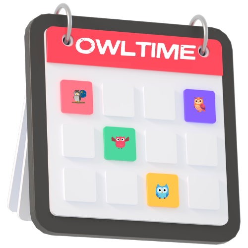

  

  <h1>Owltime</h1>
  
<strong>Planejamento escolar simples e organizado.</strong>

O Owltime ajuda escolas a organizar cadastros, planejar horários e acompanhar aulas em uma grade oficial.

## Recursos

- Cadastro de cursos, disciplinas, professores e turmas
- Organização de demandas, vínculos e disponibilidade docente
- Geração e edição de grades escolares
- Relatórios, exportações e backups
- Laboratório para testar alterações sem modificar a grade oficial

## Como iniciar

1. Sirva a pasta do projeto em um servidor web local, como o XAMPP.
2. Abra `index.html` pelo endereço local no navegador.

## Seus dados

Os dados ficam salvos no navegador e dispositivo em uso; não são sincronizados. Faça backups periódicos em **Armazenamento e backup**.

---

  <strong>Owltime</strong> · Sua rotina escolar, mais organizada. 🦉

